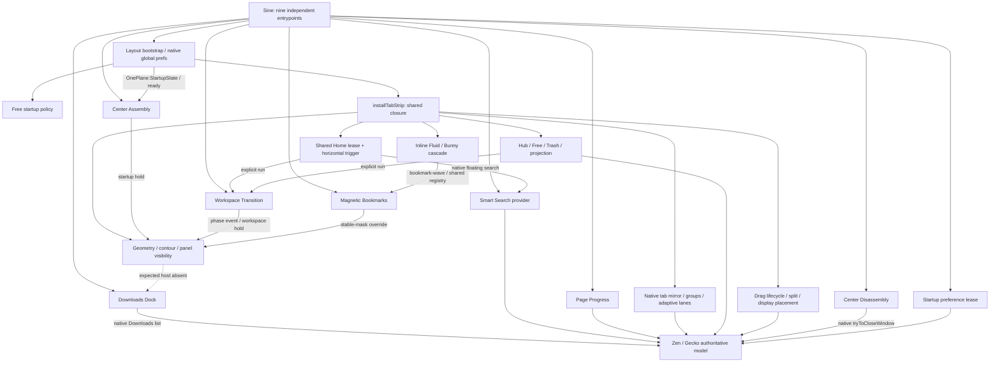

# Nocturne — full source / integration audit (preview.2)

Baseline: 00fc38d5b80c29b62b59eec6e88088a733a5e5e3 (0.3.0-preview.2). Compared against OnePlane 4281c4778f3851f939ad3cfdb01406238ff2d2a0 (0.2.0-preview.62) and Zen Refined 1926eacbe29782d80324ac277563aff514bf6943 (0.6.0-preview.26).

Status: developer reports core behavior works in Zen, with older jitter/noncritical bugs and Downloads lacking a real UI position. No fresh Gecko trace, controlled baseline screenshots, live migration/rollback or full multi-window result supplied. All source references below are to the pinned baseline; line numbers may move. This audit changes no runtime files. No new preview version is required.

## 1. Scope and transfer parity

Nine runtime scripts, 552331 bytes of JavaScript, 6750 lines in generated layout.uc.mjs, 57 JS source sections, 18 CSS source sections, 30 test files. All nine runtime entrypoints inspected, including large layout bundle and targeted underlying source sections. This is a source/lifecycle audit with targeted failure-injection fixtures, not proof of exhaustive correctness or a real browser test.

- layout.uc.mjs equals old OnePlane byte for byte. Existing horizontal source and design remain intact.
- chrome.css equals old OnePlane CSS + exact Refined non-bookmark suffix. Magnetic Bookmarks JS and CSS shared only once.
- All 32 preference definitions equal union of source definitions (23 + 15 - 6 identical overlaps). Package identity and Sine URL retained.
- Six of eight Refined scripts remain identical; startup and downloads intentionally modified by preview.2. No Refined executable feature omitted from manifest.
- Refined's optional standalone native-sidebar behavior still exists in individual controllers but Nocturne currently activates horizontal layout unconditionally where supported. User-selectable native/vertical Nocturne not implemented.
- Existing OnePlane roadmap omissions: lower-left Extension Dock, conservative 600s memory policy, full Library, Smart Context Menu, independently mountable Home/Hub and generalized Layout Manager, final split overlap polish, complete multi-monitor/live projection edge coverage. Do not label these as lost in fusion. No evidence they were finished at baseline. Refined floating-search theme unification was queued, not implemented per legacy roadmap.
- No direct comparison of native computed style/cascade between original two installed mods and unified package. CI verifies build, syntax, fixtures and published archive; does not run Zen.

## 2. Actual execution graph

This graph is an ownership/dependency map, not a literal execution order. Sine loads scripts asynchronously; independent modules must not assume manifest order.

### Cross-script contracts

| Contract | Producers | Consumers / effects |
| --- | --- | --- |
| oneplane-active, ready strip, data-op-startup-ready, OnePlane:StartupState | layout bootstrap | Assembly, Downloads, Bookmarks, Home |
| oneplane-startup-hold | Assembly | visibility |
| oneplane-home-hold / url-hold / drag-hold / hub-hold / tab-menu-hold | separate horizontal interactions | visibility reconciler |
| data-op-bookmark-wave, __zenMagneticBookmarksShared.syncAddressState | Bunny cascade | Bookmarks suspension; contour |
| __zenRefinedWorkspaceTransition.run | Workspace Transition | Home, Hub (explicit commands only) |
| data-zr-workspace-phase, ZenRefined:WorkspaceTransition | Workspace Transition | visibility/workspace hold, contour, animation CSS |
| data-zr-smart-grid, timeline, row group/rail attributes | Smart Search | native result grid, Home search snapshot |
| __zenRefinedDownloadIndicator.setHost / oneplane-download-indicator-slot / OnePlane:DownloadHostChanged | Downloads expects host | **No horizontal producer** |
| __zenRefinedPageProgress | Page Progress | standalone top-of-window overlay; no layout integration |
| BrowserCommands.tryToCloseWindow | native wrapper by Disassembly | native close command; no central transition arbitration |

## 3. Controller-by-controller assessment

| Entry | What works in source | Findings / boundaries |
| --- | --- | --- |
| layout.uc.mjs | Native tab/session ownership; adaptive mirror, native actions, Free/Trash and guards; reversible prefs; projection and drag token safeguards | NC-004, 009, 012–015, 017–020. One 6.75k-line closure, manual teardown, independent state flags. Horizontal-only hit geometry. |
| bookmarks.uc.mjs | One shared lease registry, cached rest geometry, FLIP, scoped pointer/event cleanup, reduced motion | NC-013/014: second contour calculation and CSS override; geometry passes at retarget; workspace transition doesn't use the same suspension handshake as Bunny. |
| downloads-indicator.uc.mjs | Public/private native list selection, active progress aggregation, batched painting, panel/flight, clear history not disk files | NC-008 missing host; NC-010 stale async failure destroys new instance; NC-021 narrow geometry and dedicated hold still needed. |
| smart-search.uc.mjs | Native provider registry per manager, exact tab identity, private guard, bounded zero-prefix recovery, native query wrapper | NC-011 partial install failure leaves registered provider; NC-014 result-grid updates can invalidate Home snapshot during transition. |
| startup-animation.uc.mjs | One attempt per window, prepaint/late guards, bounded 5s readiness deadline, scoped sheets, cleanup, interruption settle | NC-014/015 overlapping motion on tabs, address and bookmarks; no central priority; waiting polls via RAF within deadline. No new deterministic correctness failure found in isolated happy path. |
| closing-animation.uc.mjs | Scoped native close wrapper, bounded 520ms, second command/disabled/reduced motion fallback, restores native wrapper if owned | NC-015 eligibility excludes startup/customization/DOM fullscreen but not workspace/search/drag; transition conflict and focus/close acceptance need browser test. |
| workspace-transition.uc.mjs | Explicit native switch, outgoing/swap/incoming, timeout cleanup, supersession before native call | NC-009 native calls can overlap after first begins; NC-016 dispose can execute delayed native command; animation not applied universally to all native switch paths. |
| page-progress.uc.mjs | Top-level network events, 90ms reveal delay, throttled paint, unknown vs estimated progress, native success/failure, cleanup | NC-022 fixed root strip not orientation-specific; no dedicated fixture for selection/network stop/start/cancel/reload. No deterministic new progress defect established. |
| startup.uc.mjs | preview.2 window leases, one option observer, backup and native/default restoration; legacy warning | NC-002 remains diagnostic only; lifecycle tied to live window enumeration rather than general process coordinator; no further reproduced defect in normal tested lease flows. |

## 4. Confirmed integration gaps and reproducible defects

### NC-008 (P1) — Downloads has no real Horizontal host

downloads-indicator.uc.mjs:283–303 looks up explicit host or oneplane-download-indicator-slot; fallback parent root. Search across entire layout bundle for slot ID, controller API and event yields zero matches. CSS src/styles/refined-features.css.part:42–54 places a fixed temporary floating indicator, hides it when data-live absent. data-live only includes active downloads or open card/dock/flight (downloads:635–638). This exactly explains user's report. NC-001 corrected width gating, not host presence. A permanent utility slot, measured width, idle access, focus/keyboard, hold token, overflow and panel anchor are required. Integrate within existing planned lower-left Extension Dock area (design proposal, not approved). Do not simply force the floating fallback visible permanently. Use same native Downloads controller/list, no duplicate.

### NC-009 (P1) — Workspace Transition native operation race

workspace-transition.uc.mjs:93–123 supersedes visual transaction but does not serialize nativeSwitch already in flight. Existing lifecycle fixture from tests/workspace-transition.test.mjs:26–44, with controlled promises: run old, flush to native call; run new, flush; resolve new then old. Observed calls old-start, new-start, new-commit, old-commit. Both native operations started concurrently. This is a confirmed controller ordering defect, not proof that actual Zen's native implementation always selects the older workspace. Home and Hub have independent switching/busy guards (shared-home:903–905; hub:958–968), so callers can bypass each other's guard. Introduce native workspace command arbitration; queue/coalesce latest requested UUID, no cancellation of already-started native operation; recheck active state before starting next. Add two-caller race test.

### NC-010 (P1) — Downloads stale async rejection tears down new generation

downloads-indicator.uc.mjs:768–785 captures epoch, checks after getList/addView success, but catch unconditionally calls teardown. Actual install body executed in V8 with stub list: old addView pending; disable, re-enable, install new view successfully; reject old promise. Before rejection node=true, epoch=3; afterward node=false, epoch=4. Old error removed new instance. Fix catch to act only for current generation/ownership; track local view/list cleanup independently, handle late addView registration and removal; test disable/re-enable, rejected getList/addView and unload. Not a currently observed ordinary download failure.

### NC-011 (P1) — Smart Search partial startup failure leaves provider

smart-search.uc.mjs:365–395 registers provider, joins registry, wraps startQuery; :447 catch logs error without rollback. Existing actual-script fixture at tests/smart-search.test.mjs:60–83 with injected prefs.addObserver failure produced stage=error, registered=true, providerCount=1 (with and without optional SessionStore). Current dispose eventually removes provider, but failure leaves partially mounted feature until unload and joined prevents normal retry. Make install transactional with cleanup of registry lease, wrappers, observers and listeners, keep diagnostic stage, fail open to native search. Explicitly test late exceptions.

### NC-012 (P1) — Layout teardown exception prevents native restoration

src/core/bootstrap.js.part:1–25 calls removeTabStrip before deleting controller/restoring prefs; no finally around it. Actual cleanup body with injected removeTabStrip throw: disposed=true, applied=true, restored=false, controllerStillRegistered=true. src/core/window-lifecycle.js.part:1–117 teardown itself has unguarded observer removals, hub destroy and other operations. One optional feature failure can prevent remainder; cleanup becomes non-retryable because disposed/dead set first. Fix disposal scopes per resource, LIFO best effort, finally restore native prefs/captions/actions, record per-feature failures. Test partial mount and disposal fault injection. Native occurrence not demonstrated.

### NC-016 (P1) — Workspace transition invokes delayed native command after disposal

Actual lifecycle fixture: run then immediately dispose before outgoing promise resolves, flush; native callback count=1. workspace-transition.uc.mjs:109 only checks dead AND win.closed; dispose sets dead and aborts visual transaction without superseding. Separate user Escape (may finish requested native command) from controller unload/replacement (cancel unstarted command). Already-started native command must be allowed to settle without touching dead UI. Test both semantics.

## 5. Visual jitter and architecture risks (not yet confirmed by profiler)

### NC-013 (P2) — Two owners calculate one Fade

src/layout/contour-controller.js.part:24–98 computes --op-contour-mask/height and follows bookmark transforms for 360ms; bookmarks.uc.mjs:128–180 computes --zr-bm-contour-mask/height and sets data-zr-bm-stable-contour. CSS src/styles/magnetic-bookmarks.css.part:151–155 overrides the same actual surface. There is a concrete formula mismatch: horizontal base subtracts 0 for overflow row and 5 otherwise; bookmarks always subtracts 5. The algorithms also differ in reserved growth/bounds. Both sample layout and watch Places. Source-level ownership conflict; not proof every jitter comes from it. One surface controller should compute resting mask from layout plus explicit bookmark growth reservation, hold snapshot during motion, apply final mask once. Preserve current approved fade visuals and reduced transparency.

### NC-014 (P2) — repeated geometry and search handoff work

src/toolbar/tab-sync.js.part:112–115 synchronously centerToolbar then scheduleGeometry; geometry.js.part:120–142 calls centerToolbar again and refreshIndicator; window-lifecycle:193–198 repeats centerToolbar in ResizeObserver and schedules another pass. Some prepaint compensation is intentional to avoid a visible one-frame jump. Geometry currently mixes getBoundingClientRect/getComputedStyle and writes CSS/partition within same function. Resize feedback and multiple readers possible. Magnetic Bookmarks retarget performs several O(n) geometry passes (bookmarks:494–549). Address controller :82–120 probes WAAPI currentTime and reads style then fallback writes every RAF; do not change approved algorithm without trace. Smart Search layout changes grid attributes; Home snapshot observer :603–615 invalidates on these attributes; Home capture/collapse and startup recovery can overlap. Tab reverse lookup is O(n) per measured member (tab-adapter:45–48). Profile before changing; distinguish scheduled callbacks from real layout/reflow. Use bounded single measure/compute/commit transaction and dirty reasons, preserve synchronous compensation if evidence requires.

### NC-015 (P2) — motion conflicts / ownership

Assembly, Disassembly, Workspace Transition, Bunny, hover and Magnetic Bookmarks affect opacity/translate/scale/clip-path on overlapping nodes via WAAPI, dynamic USER_SHEET and CSS. Workspace transition excludes startup but not search/drag/closing; Disassembly excludes startup but not workspace/search/drag. Bookmark wave has synchronous suspension via shared registry, workspace motion lacks analogous explicit ownership handshake. Home and Hub each manage Escape/outside click and independent holds. No single arbitration table. Source risks, not observed exact conflict. Introduce scoped motion leases by surface and property group, explicit priority (shutdown/native safety > interaction/drag > workspace transaction > decorative hover; design to validate), cancel/settle from current rendered state; preserve current timeline/keyframes initially. Keep native commands and independent unrelated motions (e.g. page progress) separate. No blanket global animation loop.

### NC-017 (P2) — native layout preference transaction and Free startup

src/core/preferences.js.part:24–69 snapshot + restoration is reversible when clean, but applied=true before install and writes native prefs per window. A new/pending window is not counted as active; last active teardown can restore while pending mount is starting; user-changed pref may be reapplied by another activation. Bootstrap Free startup claims process before async create/reorder/selection and before validation of horizontal native capability. Claim prevents duplication but on failure may suppress retry; existing named Free deliberately requires explicit designation. Investigate process-level coordinator and explicit cold-start state, preserve private/projection routing and native session data. Do not change startup selection without approval.

### NC-018 (P2) — workspace destructive-operation partial completion and drag rollback

Hub removeSpace :341–366 revalidates, moves tabs to Trash individually, removes source only after empty; if move fails partway, already moved tabs/stamps remain; message must distinguish partial success, no silent rollback that could lose tabs. Purge :529–538 rechecks eligibility but may partially complete; report counts and native refusal. Native strip drag can unsplit before attempting cross-window adoption (drag-controller source onStripDrop); a failed adoption/reorder can leave split modified even though drop didn't complete. Existing privacy/ownership/single-window guards are valuable; add fault tests and explicit transaction outcomes before changing UI. No demonstrated tab loss.

### NC-019 (P2) — Home/Hub lifecycle and accessibility/hit regions

Home core is independently leased but only horizontal trigger mounts it; Hub constructed inside shared closure, native commands and visual geometry not separated. Home startup automatically covers panels, using inert/attribute restoration; native private windows blocked. Hub holds and command guards tied to horizontal. Need layout-independent service, separate host and focus restoration, one overlay/interaction policy; native Escape and drag regions remain bounded. Preserve .62 initial-about:blank protection and approved Home search. Actual new-tab regression not found in current source.

### NC-020 (P3) — legacy package/test policy

The package tests pin exact nine script names and 32 pref keys. Good baseline guard, but future additive settings/modules must intentionally update tests. Shared bookmark source lock pins Refined canonical hashes; move to Nocturne ownership when touching code, keep import ledger historical. Integration docs-only commit not published to preview because release workflow requires monotonic version/timestamp for each preview push. CI currently checks package after publication; add candidate preflight before broad promotion. Legacy warning NC-002 remains non-blocking; no dual-mod support claim.

### NC-021 (P2) — utility and overlay layout

Downloads setHost does not acquire a horizontal hold; syncSidebarHold only handles native sidebar panelopen (downloads:629–633). PANEL_HOLD_FLAGS lacks download hold. A hosted button/panel in Compact Mode can lose its anchor when pointer leaves top toolbar unless an explicit host-aware hold exists. Current popup placement calculates horizontal fallback from native side/anchor; ensure anchor geometry, panel viewport clamp, close/focus return and hold release across narrow/fullscreen/customization transitions. Native page actions/extension manager hide in narrow CSS <=700/520px; verify native menu overflow remains reachable. This is a design/integration gate, not reproduced user-facing failure.

### NC-022 (P3) — Page Progress layout contract and tests

Current line is root-fixed at top 3px (src/styles/refined-features.css.part:68–87) with no slot/visibility policy or host. Preserve existing behavior for Horizontal unless user approves redesign; define whether Vertical uses top edge or sidebar marker. Add tests for selected-tab switching, canceled requests, unknown progress, terminal timer, disable/reload, reduced motion. No proof of current page progress bug.

## 6. Plan / exit criteria

1. Stabilization A (before vertical): NC-008/021 utility host and Compact hold prototype, NC-009/016 shared native command gate, NC-010/011 generation-safe mount rollback, NC-012 robust teardown. Separate small runtime commits/releases; test real Zen after each. Priority ordering: native command safety and teardown first or in parallel with visible utility host. Never change all animation algorithms in same release.
2. Stabilization B: reproduce reported jerks with existing address diagnostics and Gecko profiler, compare both-mod baseline with Nocturne; NC-013/014/015 measurement and ownership. Profile cold start, hover/retarget, address open/close, Home search, workspace switch, Download open/close and resizing. Capture max frame gap, p95 frame interval and layout/reflow, active animations and node counts, no private data. No claim of FPS improvement until measured.
3. Unified Core: per-window resource scope, process native-pref ownership, native workspace command arbiter, host slots, hold tokens, readiness; isolate feature services and compatibility adapters. NC-004/017/018/019/020. Preserve current horizontal visuals and native data.
4. Layout Abstraction + Vertical: native sidebar adapter only after parity and safety gates; integrate same utility/downloads, Home/Hub, Search, bookmarks and motion contracts. No new session store.
5. Broader release: NC-002/005/006 legacy-disabled update/rollback, computed-style parity, actual runtime and safe distribution. Do not archive Refined yet.

## 7. Evidence and limitations

- Confirmed by exact source comparison: parity, absent host, two contour formulas, lifecycle/contract mismatches.
- Reproduced with actual current script bodies and controlled V8 fixtures: NC-009, NC-010, NC-011, NC-012, NC-016. These are fault/race tests, not Gecko runtime reproduction; add as permanent regression tests when implementing fixes. Existing CI preview.2 remains green.
- User reports core behavior works with inherited noncritical jitter; no exact repro steps or profiler trace for each motion. Cannot identify the actual hottest controller or guarantee all defects found. No code changes in audit.
